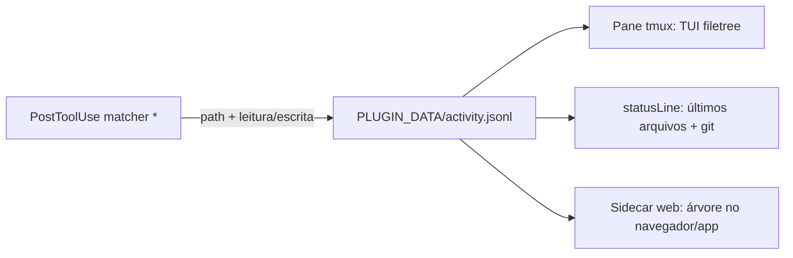

# Como portar os 4 mods do Claude Code para o Antigravity CLI

Estudo feito em 12/11/2026, no agy 1.5.7, Linux. Base do design do agy-turbo.

Fontes:

- código dos 4 projetos de origem;
- documentação oficial que vem junto com o agy, em `~/.gemini/antigravity-cli/builtin/skills/agy-customizations/docs/` (`hooks.md`, `plugins.md`, `json_configs.md`);
- changelog e guias embutidos no binário (`strings`);
- testes reais com o agy num PTY, usando `--settings`, que vale só para a sessão e não grava nada.

| Projeto | Revisão |
| --- | --- |
| [prismantis](https://github.com/NahumLitvin/prismantis) | `585f903` |
| [effortless](https://github.com/HeyCubit/effortless) | `e5c590d` |
| [claude-code-filetree](https://github.com/data-goblin/claude-code-filetree) | `3ce5b1c` |
| [Cockpit (statusline.sh)](https://statusline.sh/community/cockpit-4shq) | instalador `4shqbr1LZ9.sh`, sem licença declarada |

## Resposta curta

| Mod | Dá no agy nativo? | Como |
| --- | --- | --- |
| Cockpit (statusline) | **Sim, quase 1:1** | `statusLine` do agy recebe um JSON parecido com o do Claude Code |
| Prismantis | **Parcial** | Rules ou hook com a nota de formato. O agy já desenha Mermaid, LaTeX e código. Sem renderer próprio |
| filetree | **Não como painel lateral na TUI.** Sim como painel separado | Hooks alimentam um estado; ele é exibido num pane tmux ao lado, no statusline ou num sidecar web |
| effortless | **Só o indicador.** A troca automática de esforço, não | Hooks não mudam modelo nem esforço. Trocar por mensagem só com um cliente próprio sobre `agy acp` |

O motivo é um só. Os 3 mods do Claude Code são módulos TSX (`hooks.json` → `{"modules": ["./register.tsx"]}`) que rodam dentro do host. Usam `ui.render`, `turn.step`, `$.ui.*` e `$.store.*`. O agy não carrega módulos. A extensão dele é feita por **processos externos com JSON no stdin/stdout**. Nada do código TSX roda direto. O que se aproveita é a lógica.

## 1. O que o agy oferece para extensão

```figure
 {strong:Superfície}            {strong:Quem declara}         {strong:Pode}
 ──────────────────────────────────────────────────────────────────────────
 {accent:statusLine} (command)      settings.json / --settings  desenhar N linhas ANSI
 {accent:hooks.json}                plugin ou .agents/          ver tools, injetar texto,
                                                            bloquear, reescrever args
 {accent:rules/AGENTS.md}           plugin                      instruir o modelo
 {accent:skills/}                   plugin                      comandos /skill
 {accent:mcp_config.json}           plugin                      ferramentas para o modelo
 {accent:sidecars/} (web UI)        plugin                      painel web (aux pane)
                                                            {warn:o CLI não abre o pane}
 {accent:agy acp}                   cliente próprio             tudo, mas fora da TUI
 ──────────────────────────────────────────────────────────────────────────
 {dim:sem: render de mensagens, painel lateral na TUI, trocar esforço via hook}
```

### 1.1 Statusline (testado)

Configuração (`~/.gemini/antigravity-cli/settings.json`, ou `--settings` para teste):

```json
{ "statusLine": { "type": "command", "command": "/caminho/statusline.sh", "stack_with_default": true } }
```

- `stack_with_default: true` empilha a sua saída com a statusline padrão do agy.
- O comando `/statusline` na TUI aceita `enable`, `disable`, `reset` e `delete`.
- **Altura:** 40 linhas com cor ANSI foram desenhadas inteiras num terminal de 50 linhas. Na prática, isso funciona como um painel embaixo do prompt.
- **Quando roda de novo:** a cada mudança de estado. Foram 9 execuções nos primeiros 4 s (inicialização). Com a sessão ociosa, nenhuma em mais de 30 s. **Não há timer.** Uma contagem regressiva parada no ocioso não vai atualizar.
- Não roda em `agy -p`.
- Pelo `plugins.md`, um plugin não declara statusline. A instalação precisa editar o `settings.json` do usuário, com backup.

Payload real recebido no stdin: [`evidencias/statusline-stdin-agy-1.5.7.json`](evidencias/statusline-stdin-agy-1.5.7.json). Campos:

| Campo agy | Equivalente Claude Code | Observação |
| --- | --- | --- |
| `model.display_name`, `model.id` | `model.display_name`, `model.id` | Nome com o esforço junto, ex. `Gemini 4 Hydrogen (High)` |
| `model.effort` | `effort.level` | String direta |
| `context_window.{total_input_tokens,total_output_tokens,context_window_size,used_percentage,remaining_percentage,current_usage}` | `context_window.*` | Mesmos nomes |
| `quota.<bucket>.{remaining_fraction,reset_time,reset_in_seconds}` | `rate_limits.five_hour/seven_day.used_percentage` | **Diferente:** fração restante, vários buckets (`3p-5h`, `3p-weekly`, `gemini-5h`, `gemini-weekly`…) |
| `cost` | `cost.total_cost_usd` | Segundo o changelog, custo estimado sem arredondar. Ausente antes do 1º turno |
| `cwd`, `workspace.current_dir`, `workspace.project_dir` | iguais | |
| `transcript_path`, `session_id`, `conversation_id`, `conversation_title` | parecidos | Vazios antes da 1ª mensagem |
| `agent_state`, `sandbox.enabled`, `plan_tier`, `terminal_width`, `version`, `subagents[].model` | sem equivalente | `terminal_width` dispensa `tput` |
| `email` | — | **Não exiba** num statusline que vai aparecer em tela compartilhada |

### 1.2 Hooks (documentação oficial + changelog)

Arquivo `hooks.json` na **raiz** do plugin (não em `hooks/hooks.json`). Cada chave de topo é um hook nomeado. Os handlers são `{"type": "command", "command": "...", "timeout": 30}`, rodam com `sh -c` dentro da pasta do plugin e recebem `PLUGIN_ROOT` e `PLUGIN_DATA`.

| Evento | Recebe (camelCase) | Pode devolver |
| --- | --- | --- |
| `SessionStart` | campos comuns | `injectSteps` |
| `PreInvocation` (antes de cada chamada ao modelo) | `invocationNum`, `lastUserInput` | `injectSteps`, `terminationBehavior: "terminate"` |
| `PreToolUse` (matcher = nome da tool, regex) | `toolCall.{id,name,args}` | `decision` allow/deny/ask/force_ask, `overwrite` (reescreve args) |
| `PostToolUse` | `toolCall`, `error` | `{}` |
| `PostInvocation` | igual ao Pre | `injectSteps`, `force_continue` / `terminate` |
| `Stop` | `terminationReason`, `continuationActive` | `decision: "continue"` |

Campos comuns: `conversationId`, `workspacePaths`, `transcriptPath`, `modelName`, `lastUserInput`, `hookEventName`, `cwd`.

Tipos de passo em `injectSteps`: `systemMessage` (persiste; com `metadata.user_markdown`, **mostra Markdown só ao usuário**, sem o modelo ler), `userMessage` e `errorMessage`.

Limites: hooks são **síncronos** e travam o loop do agente. Não alteram modelo nem esforço. Não interceptam a renderização.

Nomes de tool: o nome do tipo de passo em minúsculas, sem o prefixo `CORTEX_STEP_TYPE_`. Exemplos: `run_command`, `view_file`. **Antes de escrever matchers, capture os nomes reais** com um hook `PostToolUse` de matcher `*` que grave o stdin.

### 1.3 Sidecars (guias embutidos no binário)

`plugins/<p>/sidecars/<id>/sidecar.json`:

```json
{ "command": "node", "args": ["main.mjs"], "restart_policy": "always",
  "has_web_ui": true,
  "ui_config": { "views": [ { "path": "/", "entrypoint": "SIDECAR_UI_ENTRYPOINT_AUX_PANE", "title": "X" } ] } }
```

- O processo recebe `ANTIGRAVITY_SIDECAR_WEB_PORT` e deve servir HTTP nessa porta. Os dados persistentes ficam em `ANTIGRAVITY_EXECUTABLE_DATA_DIR`.
- Exemplo pronto: `~/.gemini/antigravity-cli/builtin/plugins/swarm/sidecars/swarm_board/`.
- O aux pane existe no app Antigravity (desktop/Hub). **O changelog do CLI diz que ele "não abre" links `sidecar://`.** O `/swarm board` da TUI é uma tela nativa fixa, não um painel genérico de plugin.
- Não testado: se o CLI sobe o processo do sidecar e se a porta pode ser aberta num navegador.

## 2. Plano por mod

### 2.1 Cockpit → statusline do agy (fazer primeiro)

O Cockpit é um script bash de 2 linhas. Linha 1: modelo, esforço, `tok usado/total (%)` com barra de 30 células e custo. Linha 2: barras de uso de 5h e 7d. Lê o JSON com `jq`, com python como alternativa.

O instalador não declara licença. **Reescreva, não copie.** Mapeamento:

| Cockpit lê | No agy use |
| --- | --- |
| `model.display_name` | `model.display_name`. Remova o sufixo ` (High)`, que se repete com o esforço |
| `thinking.enabled` + `effort.level` | `model.effort` |
| `context_window.*` | igual |
| `cost.total_cost_usd` | `cost` (pode faltar; mostre `—`) |
| `rate_limits.five_hour.used_percentage` | `100 * (1 - quota["gemini-5h"].remaining_fraction)`. Use `3p-5h` quando o modelo for de terceiros (Claude) |
| `rate_limits.seven_day.used_percentage` | o mesmo, com `gemini-weekly` / `3p-weekly` |
| `tput cols` | `terminal_width` |

Extras que o agy dá de graça: `reset_in_seconds`, para mostrar quando a cota renova; `agent_state`; `conversation_title`.

Entrega: `statusline.sh` + `install.sh`. O `install.sh` faz backup do `settings.json`, depois um merge com `jq` em `statusLine` e `stack_with_default: false`. Teste sem instalar:

```bash
agy --settings '{"statusLine":{"type":"command","command":"'"$PWD"'/statusline/statusline.sh"}}'
cat docs/evidencias/statusline-stdin-agy-1.5.7.json | ./statusline/statusline.sh   # teste offline
```

### 2.2 Prismantis → plugin com rules + temas

O Prismantis no Claude Code é um renderer (cerca de 7,6 mil linhas de TSX em `ui.render`) mais uma nota de formato injetada em `prompt.submit`. O próprio autor já fez um port para um host sem render, o Codex (`prismantis/codex/`). Lá ficou **só a nota de formato + temas**. O agy está na mesma situação, com uma vantagem: o renderer nativo já desenha Mermaid em ASCII (ou como imagem Kitty) na conversa, LaTeX, realce de sintaxe e diffs.

Como fazer:

1. Plugin `prismantis-agy/` com `plugin.json` e `rules/AGENTS.md`, contendo a nota de formato adaptada de `prismantis/codex/hint.md`. Tire as partes que o agy não desenha: blocos ` ```figure ` com `{role:...}` e `xychart-beta`. Sem renderer, eles aparecem como texto cru.
2. Como alternativa às rules, um hook `SessionStart` com `injectSteps.systemMessage` carregando a mesma nota. Rules saem mais baratas e são o mecanismo previsto.
3. Temas: verifique se o `colorScheme` do agy aceita esquemas customizados. Não confirmado. Se aceitar, converta `prismantis/opencode/themes/*.json`.
4. Não refaça o renderer. A única saída para isso seria um cliente ACP próprio, e aí deixa de ser plugin.

### 2.3 filetree → estado via hooks + painel fora da TUI

O filetree usa `$.ui.panes`, `ui.render`, foco de teclado e `tool.call` para o "shimmer". São cerca de 8,2 mil linhas. A TUI do agy não tem painel lateral para plugins. Separe em duas partes.



1. **Coletor** (hook do plugin): `PostToolUse` com matcher `*` lê `toolCall.name/args`, extrai o caminho e classifica em leitura, escrita ou git. Grava uma linha em `$PLUGIN_DATA/activity.jsonl`. Precisa ser rápido (menos de 50 ms), porque hooks travam o agente. Mapeie os nomes de tool do agy antes. A regra de leitores do Bash (`rg`, `grep`, `cat`) está em `claude-code-filetree/hooks/work.ts` e `peek.ts`.
2. **Visualização**, escolha uma:
   - **A, recomendada para "na lateral":** um app TUI próprio (Go/bubbletea, Python/Textual ou Rust/ratatui) aberto num `tmux split-window -h -l 40`. Lê o diretório e o `activity.jsonl` e reaproveita as regras de `tree.ts`, `git.ts`, `icons.ts` e `palette.ts`. Um `SessionStart` pode abrir o pane quando `$TMUX` existir.
   - **B:** statusline com um resumo (últimos N arquivos tocados, branch, ahead/behind). Atualiza a cada evento, não no ocioso.
   - **C:** sidecar web. Serve no desktop Antigravity. No CLI depende do ponto não testado da seção 1.3.
3. Não porta: clique, multi-seleção que vira contexto do Claude, `/cd` automático. O agy não deixa um hook mudar o cwd nem anexar arquivos ao prompt. O **guard** de arquivos porta bem: `PreToolUse` com `decision: "deny"` nas tools de escrita.

### 2.4 effortless → indicador + aviso; troca automática só fora da TUI

O núcleo do effortless é `turn.step`, que reescreve `effort` em cada requisição (`effortless/hooks/register.tsx`). Um juiz Haiku em `prompt.submit` decide o nível. **O agy não tem equivalente:** nenhum hook altera modelo ou esforço.

Caminhos:

1. **Nativo, limitado:** um hook `PreInvocation` com `invocationNum == 1` roda um classificador local (palavras-chave, como `parseVerdict` e `asked` em `register.tsx`) e injeta `systemMessage` com `metadata.user_markdown`. O usuário vê algo como "sugestão: esforço high, rode /model", e o modelo não vê nada. O statusline mostra `model.effort` e a cota.
2. **Troca real:** cliente próprio sobre `agy acp`, que tem `session/set_config_option` para o nível de raciocínio. Só que ele substitui a TUI do agy. É a opção mais cara.
3. Não porta: contador de cache (o statusline não recebe TTL nem leituras de cache), handoff e compactação customizada (não há hook de compactação).

## 3. Ordem sugerida

```figure
 {strong:1} Cockpit statusline      {ok:1 dia}     {dim:valida instalação + payload}
 {strong:2} Coletor de atividade     {ok:1 dia}     {dim:base de filetree e effortless}
 {strong:3} Prismantis rules         {ok:½ dia}     {dim:texto, sem código}
 {strong:4} filetree em tmux         {note:1-2 sem}  {dim:o maior trabalho}
 {strong:5} effortless sugestão      {ok:1 dia}     {dim:hook + classificador local}
 {strong:6} sidecar / ACP            {warn:só se 1-5}  {warn:não bastarem}
```

## 4. Pendências antes de implementar

- Capturar os nomes reais das tools e o formato de `args` (hook `PostToolUse` `*`).
- Confirmar que `cost` e `conversation_title` aparecem no payload depois do 1º turno. A captura atual é da inicialização, sem turno.
- Ver se o `colorScheme` aceita temas customizados.
- Testar se o CLI sobe sidecars e se a porta responde num navegador.
- `agy plugin validate --strict` em cada plugin antes de instalar.

## 5. Reproduzir a captura do statusline

```bash
export OUT=/tmp/sl && mkdir -p $OUT
cp docs/evidencias/statusline-dump.sh $OUT/ && chmod +x $OUT/statusline-dump.sh
timeout 25 script -qfc "agy --settings '{\"statusLine\":{\"type\":\"command\",\"command\":\"$OUT/statusline-dump.sh\"}}'" /dev/null </dev/null
python3 -m json.tool $OUT/stdin.json
```
